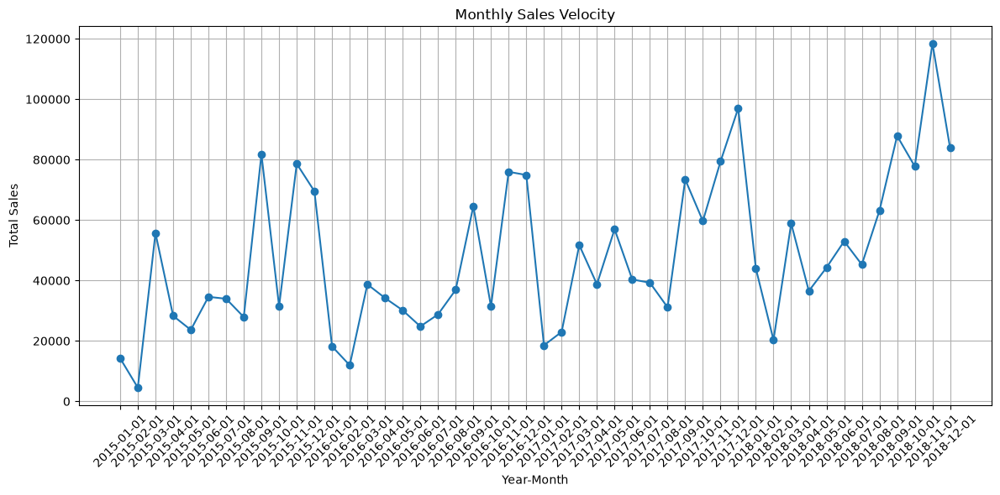
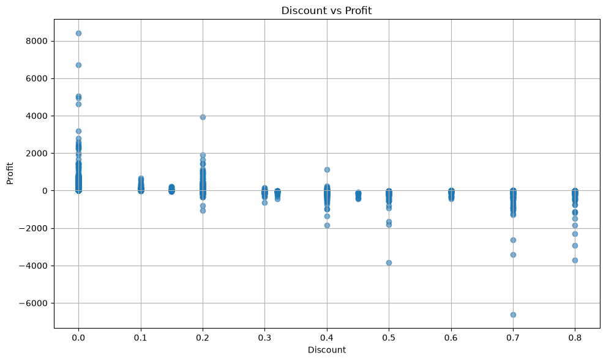

# Superstore Sales Analysis

## Project Overview

This project analyses the Superstore sales dataset using Python to understand sales performance, profitability, monthly trends, product categories, regional performance, customer segments, and the relationship between discounts and profit.

The project applies data-cleaning techniques, exploratory data analysis, aggregation with Pandas, and visualisation with Matplotlib to turn transaction data into business observations and recommendations.

## Table of Contents

- [Dashboard Preview](#dashboard-preview)
- [Key Business Insights](#key-business-insights)
  - [Overall Performance](#1-overall-performance)
  - [Monthly Sales Performance](#2-monthly-sales-performance)
  - [Product Category Performance](#3-product-category-performance)
  - [Regional Performance](#4-regional-performance)
  - [Customer Segment Performance](#5-customer-segment-performance)
  - [Discount and Profit Relationship](#6-discount-and-profit-relationship)
  - [Underperforming Sub-Categories](#7-underperforming-sub-categories)
- [Key Business Recommendations](#key-business-recommendations)
- [Assumptions and Limitations](#assumptions-and-limitations)
- [How to View the Analysis](#how-to-view-the-analysis)
- [Tools and Technologies](#tools-and-technologies)
- [Repository Structure](#repository-structure)
- [Author](#author)
- [About](#about)

## Dashboard Preview

### Monthly Sales Performance



### Discount vs Profit



## Key Business Insights

### 1. Overall Performance

| Metric | Result |
|---|---:|
| Valid sales records | 9,994 |
| Distinct orders | 5,009 |
| Total sales | $2,297,200.86 |
| Total profit | $286,397.02 |
| Overall profit margin | 12.47% |
| Loss-making transaction lines | 1,871 |

The dataset generated positive overall profit. However, the loss-making transaction lines show that not every transaction was profitable.

### 2. Monthly Sales Performance

- Highest-sales month: **2018-11** — $118,447.82.
- Lowest-sales month: **2015-02** — $4,519.89.
- Annual sales declined by **2.83%** in 2016 compared with 2015, then increased by **29.47%** in 2017 and **20.36%** in 2018.

The monthly trend can help the business monitor changes in demand and investigate seasonal patterns. Sales should be reviewed alongside profit to ensure that revenue growth is also profitable.

### 3. Product Category Performance

| Category | Sales | Profit |
|---|---:|---:|
| Technology | $836,154.03 | $145,454.95 |
| Furniture | $741,999.80 | $18,451.27 |
| Office Supplies | $719,047.03 | $122,490.80 |

- **Technology** generated the highest sales.
- **Technology** generated the highest total profit.
- Furniture recorded a comparatively weaker profit contribution relative to its sales.

### 4. Regional Performance

| Region | Sales | Profit |
|---|---:|---:|
| West | $725,457.82 | $108,418.45 |
| East | $678,781.24 | $91,522.78 |
| Central | $501,239.89 | $39,706.36 |
| South | $391,721.91 | $46,749.43 |

- **West** recorded the highest sales.
- **West** generated the highest profit.
- **Central** had the lowest profit margin among the four regions.

### 5. Customer Segment Performance

| Segment | Sales | Profit |
|---|---:|---:|
| Consumer | $1,161,401.34 | $134,119.21 |
| Corporate | $706,146.37 | $91,979.13 |
| Home Office | $429,653.15 | $60,298.68 |

- **Consumer** contributed the highest sales.
- **Consumer** generated the highest total profit.
- **Home Office** had the highest profit margin among the customer segments.

### 6. Discount and Profit Relationship

- The Pearson correlation between discount and profit was **-0.219**, indicating a negative association in the transaction-level data.
- This association does not prove that discounts alone caused lower profits.
- High-discount transactions should be reviewed with product mix, sales value, and transaction volume in mind.

### 7. Underperforming Sub-Categories

The five lowest-profit sub-categories were:

| Sub-Category | Total Profit |
|---|---:|
| Tables | $-17,725.48 |
| Bookcases | $-3,472.56 |
| Supplies | $-1,189.10 |
| Fasteners | $949.52 |
| Machines | $3,384.76 |

These sub-categories warrant further review of pricing, costs, product mix, and discounting.

## Key Business Recommendations

1. **Review discount policies:** Evaluate high-discount transactions and establish controls that protect profit margins.
2. **Investigate Furniture profitability:** Examine Furniture sub-categories and identify the factors contributing to weaker profit.
3. **Learn from stronger regions:** Review the West's performance and identify practices that may be useful in other regions.
4. **Improve regional profitability:** Investigate the factors behind Central's comparatively low profit margin.
5. **Develop segment-aware strategies:** Maintain the Consumer segment's contribution while studying the higher-margin purchasing patterns of Home Office customers.
6. **Monitor sales and profit together:** Track both measures monthly so that higher revenue is not mistaken for stronger profitability.
7. **Separate source tables correctly:** Keep the returns lookup section separate from the sales transaction table and connect it using order identifiers when returns analysis is required.

## Assumptions and Limitations

- The uploaded CSV contains **9,994 valid sales transaction rows** and an additional **302 rows** that appear to belong to a separate returns lookup section appended under mismatched column headings.
- The 302 rows were not treated as sales transactions or included in the sales calculations.
- Monthly sales analysis uses records with valid order dates.
- Discount-profit correlation indicates association, not causation.
- The analysis is descriptive and does not establish why sales, profit, or customer behaviour changed.
- Profitability conclusions are based on the `Profit` field supplied in the dataset.

## How to View the Analysis

1. Clone or download this repository.
2. Open the project folder in Visual Studio Code or your preferred Python environment.
3. Ensure Python and the required libraries are installed.
4. Open and run the analysis notebook or Python script.
5. Review the visualisations in the `images/` folder and the detailed findings in `Business_Observations.md`.

Install the main libraries with:

```bash
pip install pandas matplotlib
```

## Tools and Technologies

- **Python** — data analysis and scripting.
- **Pandas** — data cleaning, grouping, aggregation, and date handling.
- **Matplotlib** — data visualisation.
- **CSV** — source dataset format.

## Repository Structure

```text
Superstore-Sales-Analysis/
│
├── images/
│   ├── monthly_sales_velocity.png
│   └── discount_vs_profit.png
│
├── data/
│   └── superstore_sales.csv
│
├── Business_Observations.md
├── README.md
└── Superstore_Sales_Analysis.ipynb
```

The repository structure above is a suggested layout. Add the dataset and analysis file to the corresponding folders when organising your repository.

## Author

**Hassan Rosheedat Temitayo**

Data Analyst | Excel | SQL | Power BI | Python

[E-mail](mailto:rosheedathassan7@gmail.com) | [LinkedIn](www.linkedin.com/in/hassan-rosheedat-570a6340a)


## About

Superstore Sales Analysis is a practical data analytics project focused on preparing, exploring, and visualising retail sales data. It demonstrates the use of Python, Pandas, and Matplotlib to identify business patterns, assess profitability, and communicate findings through clear observations and recommendations.
